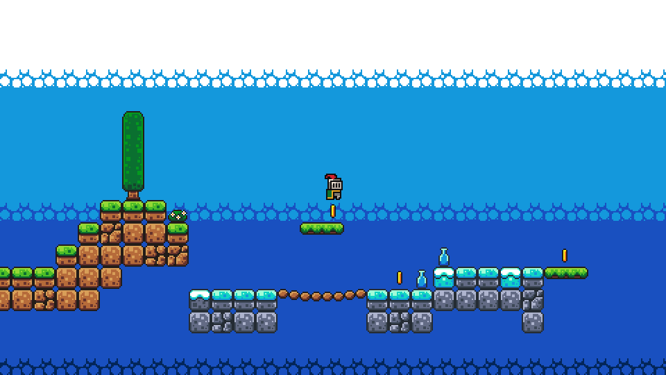
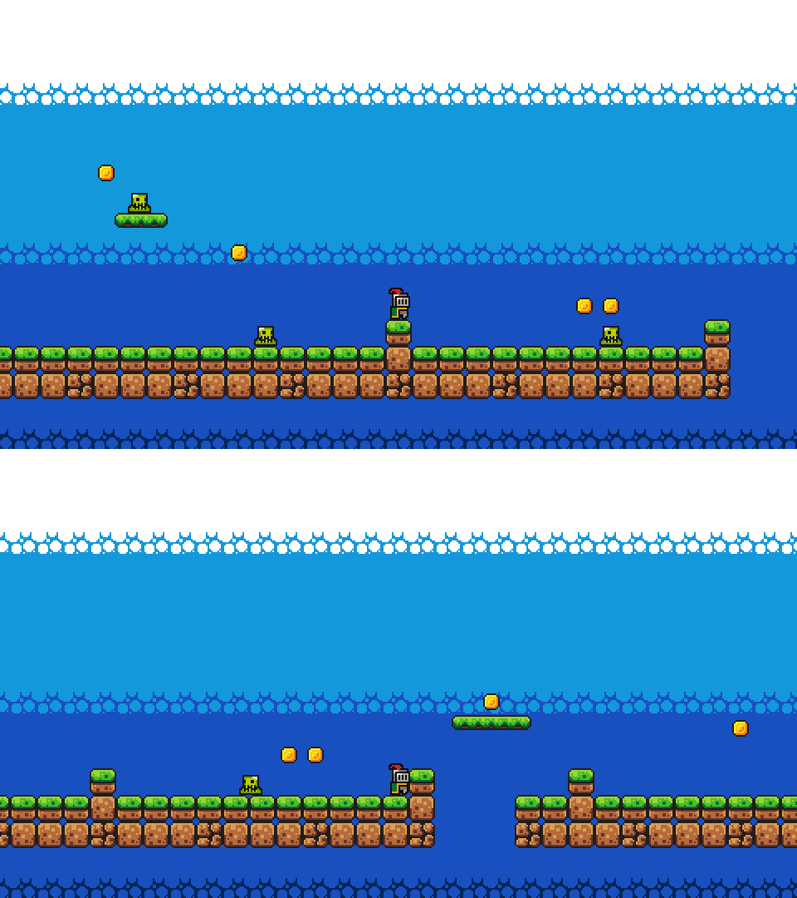

# platformer-ai

A small platformer written as pure JAX functions, plus PPO. Environment stepping, the policy, GAE and the
optimiser updates all run inside **one jitted function on the GPU**: no game engine, no CPU round trips
(the CPU only dispatches the update and reads back a few logging numbers). A pygame window lets you watch
the trained agent, or take over and play the same level yourself.



On an RTX 3050 laptop GPU (plugged in), 25M environment steps take about a minute (~600k steps/s). The
included policy reaches the flag in 99% of fixed evaluation episodes with random platform/enemy phases
(return 13.9 of a possible 14).

## Quick start

Needs [uv](https://docs.astral.sh/uv/), which installs the Python version pinned in `.python-version`. The lockfile targets an NVIDIA GPU with CUDA 13
(`jax[cuda13]`); for CUDA 12 use `jax[cuda12]`, for CPU-only plain `jax` (it works, just slower).

```bash
git clone https://github.com/plant7-arch/platformer-ai.git
cd platformer-ai
uv sync

uv run python -m platformer_ai.viewer                 # watch the latest trained agent (Tab: play yourself)
uv run python -m platformer_ai.train                  # train your own: 25M steps, into a new runs/<date>_<time>/
uv run python -m platformer_ai.runs                   # list the runs; the latest one is what viewer / play use
uv run pytest                                         # tests
```

Optional JAX settings: put these in a `.env` file (it is git-ignored) and run `uv run --env-file .env ...`,
or `export` them in your shell:

```
XLA_PYTHON_CLIENT_PREALLOCATE=false      # do not grab all GPU memory up front
JAX_COMPILATION_CACHE_DIR=.jax_cache     # faster start from the second run on
```

If you run out of GPU memory, lower `--num-envs` (default 1024). On a laptop, plug it in: the GPU runs in a
much lower power state on battery and training can be several times slower.

## Project layout

```
src/platformer_ai/
  level.py      the level as ASCII (edit it! also holds the S start points)
  levelcheck.py checks the level when it loads: errors with row/col, warnings in the log
  levelgen.py   random levels in 3 difficulty tiers (valid and beatable), writes gen/train/ and gen/test/
  levelsettings.py  the generator's settings: built-in tiers, settings file + options, checks
  levelplan.py  beam search over the real env: can a level be finished? (used by levelgen)
  env.py        reset / step / observe: pure functions on a small pytree; vmap for many envs; the level is an input
  cli.py        the --level FILE option of viewer / play
  runs.py       run folders, finding the latest run, `python -m platformer_ai.runs` lists them
  ppo.py        PureJaxRL-style PPO (MLP actor-critic)
  evaluate.py   fixed GPU evaluation (also during training); `python -m platformer_ai.evaluate` scores a policy on levels
  train.py      training loop, prints metrics + periodic evaluation, saves params
  play.py       watch a trained policy in the terminal (ASCII)
  render.py     ASCII rendering
  terminal.py   alternate-screen drawing used by play.py
  viewer.py     pygame window: watch the agent or play yourself (reads the env, never trains)
  viewlogic.py  viewer logic without pygame/jax: coordinates, animation, camera, controls
  scene.py      numpy renderer for one 480x270 frame (tilemaps + sprites)
  terrain.py    draws terrain, backdrop, decorations and the goal flag from the ASCII level (so level edits show up)
assets/         sprites/ and fonts/ from the Brackeys platformer bundle (CC0)
runs/           one folder per training run (params.msgpack, run.json, levels.txt); runs/pretrained/ = the included policy
tests/          env behaviour tests, viewer-logic tests, a PPO smoke test
```

## Training: what the options do and how to read the log

The level has two hard parts (the ferry and the enemy) that a random policy practically never gets
through, so plain PPO from the spawn stalls after the first coins. The switches below fix that:

* **Random phases** (`--no-random-phases` turns them off). Every episode starts with the platform and the
  enemy at random phases, and the spawn position is jittered. With fixed phases the agent can learn one
  timed route by heart and never look at the platform or the enemy; with random phases it has to react.
* **Random starts** (`--no-random-starts` turns them off). With probability `1 - spawn-prob` (default
  0.5) an episode begins at one of the `S` points in `level.py` or riding the ferry, so the hard parts are
  practised directly. `play` always starts at the spawn.
* **Progress bonus** (`--progress-coef 0.1`, `0` = off): +0.1 per tile of *new* furthest-right progress.
  Walking back and forth pays nothing, waiting costs nothing (the ferry needs waiting).
* Longer horizon: `gamma` 0.995 and 128-step rollouts.

```
upd   60/190  steps ...  SPAWN eps  310 return  6.20 coins  5.1 goal 0.30 max_x  52.3 len  612 | ALL return ... 
    EVAL greedy   512 fresh episodes, random phases:  return 13.80  coins  8.9  goal 0.98  max_x  68.5  len  291
    EVAL sampled  512 fresh episodes, random phases:  return 13.10  coins  8.7  goal 0.93  max_x  67.9  len  300
```

**How much it prints**: `--verbosity` (`-v`) 0 to 3.

| `-v` | progress lines | evaluations |
| --- | --- | --- |
| 0 | none | only the final one, in full |
| 1 (default) | about 40 per run (the first update, then every ~1/40 of the run) | one line each (`EVAL upd 40  greedy goal ... \| sampled ... \| UNSEEN ...`), the final one in full |
| 2 | every update | every one in full |
| 3 | every update | every one in full, naming every level even when there are hundreds |

`--log-every N` sets the progress interval yourself. A progress line averages the updates since the previous line
(at least the last 10).

* **`EVAL` lines are the number to trust** (every 20 updates, `--eval-every`). 512 fresh episodes from the
  real spawn with random phases, always the same 512 start conditions, each run to its very end
  (900 steps). `greedy` = most likely action, `sampled` = like the training policy. Max return is 14;
  `goal` is the share that reaches the flag. If `goal` is high here, the agent really reacts to the
  platform and enemy.
* `SPAWN ...` (every update) only averages episodes that have *finished*, so while many episodes are still
  running it looks better than reality (stuck episodes only count when they time out after 900 steps).
  Use it for trends, not for absolute values.
* `ALL ...` includes the random starts (easier on average). Everything is averaged over 10 updates.
* Logged returns are the task return (coins + goal + death); the progress bonus is only used for training.

If the spawn is learned too slowly, raise `--spawn-prob` (e.g. 0.75, or 1.0 with `--no-random-starts`);
if the agent only works from the spawn but not from the other starts, lower it.

`play --random-phases` shows an agent with random phases and a jittered spawn.

`play` draws on the terminal's alternate screen (like `vim` or `htop`): your scrollback, including the
end of the training log, stays intact, and the per-episode results are printed after the game view closes.
Ctrl-C leaves cleanly. When stdout is not a terminal (piped), it only prints the results.

## Runs: keeping several trainings

Every training run gets its own folder, so nothing is overwritten:

```
runs/2026-10-14_205407/                  uv run python -m platformer_ai.train
runs/2026-10-14_211502_three_levels/     uv run python -m platformer_ai.train --levels docs/levels/ --name three_levels
    params.msgpack    the policy (saved every 25 updates and at the end)
    checkpoint.msgpack  network + optimiser state + random key, saved with it (what --resume needs)
    run.json          command, levels, settings, steps done, last evaluation, finished or not
    levels.txt        the level files it trained / was tested on
```

`--out DIR` picks the folder yourself. **The latest run** is your run whose `params.msgpack` was saved most recently
(a run that is still training counts, so you can watch it learn); `viewer` and `play` use it unless you pass
`--params` (a run name, a run folder or a `.msgpack` file). `runs/pretrained/` (the policy that comes with the
repository) is only used when you have no runs of your own, or with `--params pretrained`. See them all:

```bash
uv run python -m platformer_ai.runs
  run                              saved                   steps  levels   goal  return  status
  pretrained                       2026-10-14 21:40              -       -      -       -  shipped with the repository
* 2026-10-14_211502_three_levels   2026-10-14 21:16   24,903,680       3   0.96    7.22  done
```

**Resuming.** A run that stopped (Ctrl-C saves the last finished update and prints the command; a crash loses at
most the updates since the last save, every 25) goes on where it was:

```bash
uv run python -m platformer_ai.train --resume                         # the latest run
uv run python -m platformer_ai.train --resume 2026-10-14_205407       # a given run (name or folder)
uv run python -m platformer_ai.train --resume --total-steps 50000000  # a finished run: train it longer
```

The settings and levels come from the run's `run.json` (only `--total-steps` and `--eval-every` can be given), the
network, the Adam state, the learning-rate schedule and the random stream continue exactly; the environments start
fresh episodes. With a bigger `--total-steps` the learning-rate schedule is stretched to the new end, so the rate
picks up again from `lr x (1 - done / new total)` and decays to 0.

**Training on from a policy that has no checkpoint** (`runs/pretrained/`, which only keeps `params.msgpack` in git,
or runs made before `--resume` existed) starts a *new* run whose network begins with those weights, with any levels
and settings you like; only the optimiser and the learning-rate schedule start fresh:

```bash
uv run python -m platformer_ai.train --init-from pretrained --levels docs/levels/ --name more_pretrained
uv run python -m platformer_ai.train --init-from 2026-10-14_212223 --levels my_levels/
```

To ship a new policy, copy a run's `params.msgpack` into `runs/pretrained/`. The `.gitignore` keeps every run out of
git except that file:

```
runs/*
!runs/pretrained/
runs/pretrained/*
!runs/pretrained/params.msgpack
```

(Also un-ignore `runs/pretrained/checkpoint.msgpack` and `runs/pretrained/run.json`, and copy them along, if the
shipped policy should be resumable with `--resume pretrained`; the checkpoint is about three times the policy's size.)

## The viewer (pygame)

```bash
uv run python -m platformer_ai.viewer                                     # the latest run
uv run python -m platformer_ai.viewer --params 2026-10-14_205407_three     # a run by name (or a folder / .msgpack)
```

A 480x270 picture scaled up in whole-number steps (the window is resizable), camera following the knight,
knight / slime / coin / platform animations, coin counter. Run it from the repository root so it
finds `assets/` (or pass `--assets DIR`).

| key | action |
| --- | --- |
| `Tab` | switch between the **agent** and **you** (same level, same physics) |
| arrows / `A` `D`, `Space` / `Up` / `W` | move, jump |
| `P`, `.` | pause, advance one step while paused |
| `R` | restart the episode |
| `Esc` / `Q` | quit |

Options: `--human` (start with the keyboard), `--sample`, `--random-phases`, `--scale N` (initial window size),
`--theme grass|sand|ice`, `--no-decor`, `--assets DIR`, `--seed`. Without a params file it starts in keyboard mode.

The viewer runs one env on the **CPU** (`JAX_PLATFORMS=cpu` is set unless you set it yourself), so it never
touches the GPU, even while a training run is going. The art is only pictures: the physics are `env.py`, and
the sprites are placed from the env state (feet position, one tile = 16 px).

**The picture follows the level.** The terrain is generated from the ASCII in `level.py` (`terrain.py`): a solid
cell with air above it gets a grass top tile, any other solid cell a dirt tile (a position hash varies them, the same
every run), small bushes and mushrooms are sprinkled on free ground, the sky/water backdrop is generated for any
width, and every `G` gets a flag. So editing `LEVEL` is enough; the signs (`LABELS` in `level.py`) are optional.

## The game (ported from the original Godot level)

* **Level**: the 70 x 10 tile collision map of the Godot project, as ASCII in `level.py`
  (the 3 nearly flat slope tiles became flat solid tiles).
* **Player**: a 0.6 x 0.8 box. Run left/right, jump about 2.7 tiles high (only from the ground or a platform).
  Units are tiles; one env step = 1/30 s.
* **Actions (6)**: horizontal `[none, left, right][a % 3]`, jump when `a >= 3`.
* **One-way platforms**: a static one (spawn drops onto it; it is out of reach from the ground) and a
  moving one that ferries the player across the 8-tile pit while carrying whoever stands on it. A level may
  have any number of moving platforms (also none).
* **Enemies**: each patrols between its own two x limits (given in the level; a wall inside the path is reported as an error), touch = death.
  A level may have any number of them (also none). One standing on a platform walks on it and is carried along by it.
* **Coins**: 9 (8 on the map, 1 of them sitting on the moving platform), circles with the original 5 px radius. Only
  coins drawn in the map exist; an `o` right above a moving platform sticks to it.
* **Goal**: a flag at the far right. The original level had no way to win; this is the one addition.
* **Speeds**: our player is slower than the Godot one (6 vs 11.25 tiles/s), so the platform and the
  enemy were scaled by the same factor (3.2 and 2.0 tiles/s); relative timing is preserved.
* **Reward**: +1 coin, +5 goal (ends the episode), -1 death by pit or enemy (ends the episode).
  Max return is 9 coins + 5 = 14. A scripted bot that waits for the ferry and hops the enemy scores 12.
* Episode is cut at 900 steps and treated as truncation (PPO bootstraps from the last state's value).
* **Observation (778 floats)**: 9 x 17 tile window around the player with 5 channels (solid, one-way /
  moving platform, coin, goal, enemy) plus 13 scalars: velocity, on-floor, sub-tile position, progress,
  time used, and relative position + direction of the *nearest* enemy and of the *nearest* moving platform
  (the window shows all of them; with none in the level these scalars read "far away, standing still").
  The size is the same for every level, so a policy file fits any enemy / platform count (but see below).

## Editing the level

The level is the ASCII picture `LEVEL` in `level.py`:

| symbol | meaning | symbol | meaning |
| --- | --- | --- | --- |
| `#` | solid tile | `-` | one-way platform (stand on it, pass through from below) |
| `o` | coin | `G` | goal (touch = win) |
| `P` | player spawn (exactly one) | `E` | enemy (any number, each `E` is one enemy) |
| `S` | extra start point (optional, used by random-start training) | `M` | moving platform: a run of `M` tiles in a row is one platform (any number) |
| `.` | empty | | |

The level is **checked every time it loads** (`levelcheck.py`), so a mistake fails early and says where
(rows and columns count from 1, like the line numbers in your editor):

```
the level has 2 problems (rows and columns count from 1):
  [unknown-symbol] not a level symbol: 'p' at row 2, col 10 (did you mean 'P'?).  Valid symbols: . # - o G P E S M
  [spawn-count] needs exactly one 'P' (player spawn), found 2: row 1, col 4; row 4, col 18
```

**Where things move** is written under the map, after a blank line, one line per mover (x in tiles, the centre of
the thing; row and column count from 1, like the messages; `#` starts a comment). This is the end of the built-in level:

```
...........####....###....#...........................................

platform 8 28 to 34
enemy 7 49 from 44.5625 to 52.4375
```

* `platform ROW COL [to STOP_X]`: the platform with an `M` tile at ROW, COL starts where its `M` tiles are,
  moves to `STOP_X` (left or right of the start) and back.  (`no-coin`, from older levels, is still accepted and does nothing.)
* `enemy ROW COL from MIN_X to MAX_X`: the enemy at ROW, COL starts at its `E` and walks between those two x.
* No line: a platform moves 6 tiles to the right of its start, an enemy walks 3 tiles either way of its start
  (`DEFAULT_PLATFORM_TRAVEL`, `DEFAULT_ENEMY_REACH` in `level.py`). Walls never shorten an enemy's path: a wall inside
  it is an error that names the cells, so you move the wall or the limits.

* **Errors** stop the program, all of them at once: rows of different length, unknown symbols (typos), not exactly
  one `P`, bad path lines (unknown form, no such platform / enemy there, two lines for one, `from` > `to`), and
  paths that are not valid. For a **platform path** (everything the platform covers, edges included): it leaves the map,
  it does not move at all, it sweeps through a solid tile, a static `-` tile, a coin, the goal, the spawn or a start
  point `S`, it shares a stretch of its row with another platform, or with an enemy. For an **enemy path** (its body
  included): it leaves the map, it is shorter than 0.2 tiles, the enemy does not start inside it, it runs through a
  solid tile, a `-` tile, a coin or the goal, a hole in the ground below it (enemies do not fall), it shares a
  stretch of its row with another enemy, or it can reach the player at the real spawn (the player would be hit at the
  start; random starts push enemies away, the real spawn does not). Start points `S` inside an enemy path are fine.
* **Warnings** are logged and the level still loads: no goal `G`, a start point with no ground within 4 tiles below,
  an enemy path that comes within 3 tiles of the spawn, and coins / goals / start points that are completely
  walled in by solid tiles.

**Enemies on platforms, coins on platforms.**

* An `E` standing right on an `M` tile **rides that moving platform**: it walks on it between the platform's ends and is
  carried along, so its own walking speed adds to the platform's speed. Without a path line it walks the whole
  platform; with one, `MIN_X` / `MAX_X` are x *on the platform at its start*, and the enemy's body must stay on the
  platform (`enemy-rides-outside` otherwise).
* An `E` standing on a run of `-` tiles patrols only that run (same rule, with the run as the platform).
* An `o` right above an `M` tile is **stuck to that platform** and moves with it. A platform has a coin only if
  you draw one.
* Checks on top of the path checks: a rider may not walk through a coin stuck to its platform, a stuck coin may not travel through solid tiles, two riders on
  one platform may not share a stretch, another platform in a rider's row may not sweep through it, and solid tiles
  right above a platform's path give a warning (nobody can stand or ride there).

```
.....E...o..........         enemy 3 4 from 2.5 to 5       <- on the platform at its start
..MMMMM.............
```

Several enemies and platforms: `E` and `M` can appear as often as you like. Neighbouring `M` tiles in a row are one
platform of that width, so `MM.MM` is two 2-wide platforms (a stray gap splits a platform!). Enemies and platforms are
numbered row by row, left to right,. With no `E` or no `M` at all the level
still loads and trains; the observation keeps its size.



Try it: `PLATFORMER_LEVEL=docs/example_many.txt uv run python -m platformer_ai.viewer` (the level in the picture,
with its path lines).

To check a level while you edit it, without starting anything else (a text file with the map rows and optional path lines also works):

```bash
uv run python -m platformer_ai.levelcheck                 # the level in level.py
uv run python -m platformer_ai.levelcheck my_level.txt
```

To try a level **without editing `level.py`**, put the ASCII rows in a text file and point `PLATFORMER_LEVEL` at it;
it works for every command (`viewer`, `train`, `play`, `levelcheck`) and is validated the same way:

```bash
PLATFORMER_LEVEL=my_level.txt uv run python -m platformer_ai.viewer
```

Small levels work: a platform needs room for its whole path, and nothing else sets a minimum size (a 1-row level renders and runs; the viewer just shows a lot of sky).
`tests/test_tiny_levels.py` runs the real environment on small or odd levels, with and without enemies / platforms, and `tests/test_multi.py`
checks what several enemies and platforms do (killing, carrying, rider coins, nearest-thing scalars, random starts) (a few minutes in total, one process per level because they use the default level of `env.py`). `tests/test_levels_input.py` checks several levels of different sizes in one padded set.

A level that is not valid stops the program with a short message (which file, every problem with row / column or line,
and the command to check it) instead of a traceback; warnings are logged with the file name too.

The check cannot tell whether a level is *beatable*: it finds things that are walled in completely, but not ones that
are just too high or too far for the jump (about 2.7 tiles). Train an agent on it to find out, and retrain after any
change. The included policy (`runs/pretrained/`) was trained on the three small levels in `docs/levels/` only; it
loads for any level (the observation size is fixed) but has never seen the others, the built-in level included. To
get a policy that plays many levels, train on many levels (next section).

## Several levels: the level is an input

The environment does not have the level built in: it takes it as data. `env.make_levels([...])` packs any number of
levels of any sizes into one set of arrays, padded to the largest map and the largest numbers of enemies, platforms,
coins and start points (masks switch the unused slots off, so they never move into view, kill or count). Every
environment carries the index of the level it plays (`state.level`), and each reset picks a random level, so every
training batch mixes all of them. The observation is the same 778 numbers for every level, so one network plays them
all and old checkpoints still load.

```bash
uv run python -m platformer_ai.levelcheck my_levels/                     # check them all first
uv run python -m platformer_ai.train --levels my_levels/ extra.txt       # train on all of them at once
uv run python -m platformer_ai.train --levels my_levels/ --test-levels unseen/   # + evaluate on levels it never sees
uv run python -m platformer_ai.viewer --level unseen/hard.txt            # watch the policy on any level
uv run python -m platformer_ai.play --level unseen/hard.txt
```

A folder stands for all `*.txt` files in it (`docs/levels/` has three small ones to start with:
`--levels docs/levels/`). Without `--levels`, training uses the level of `level.py` (or
`PLATFORMER_LEVEL`), exactly as before. With several levels the evaluation prints one line over all of them and one
line per level; `--test-levels` adds an `UNSEEN` evaluation on levels that are never trained on, which is the honest
test of whether the agent learned to *play* rather than to memorise. The level names of a run are saved in
`runs/.../levels.txt`.

In code:

```python
from platformer_ai import env as E, level as L
levels = E.make_levels(L.load_all(["my_levels/"]))            # or [L.build(text, "name"), ...]
state = E.reset(key, levels=levels)                           # a random level; level=i for a given one
state, obs, reward, done, info = E.step(state, action, levels=levels)          # keep_level=True: stay on it
obs = E.observe(state, levels)
```

Leaving `levels` out means the level of `level.py`, so a single-level run behaves exactly as before (same numbers).
The one visible difference inside a padded set: when the player falls out of a level that is shorter than the
tallest one, the observation window keeps showing the empty rows below it instead of stopping at the map's edge.

## Generated levels: many levels it has never seen

`levelgen` writes random levels: spawn on the left, flag on the right, 40 to 80 tiles wide, 10 to 12 rows, built from
segments (flat ground, steps, gaps, ledges, ferries over pits, patrolling enemies, stepping stones, upper platforms with
coins, riders on platforms and ledges), with a start point `S` in front of every hard part.

```bash
uv run python -m platformer_ai.levelgen                    # gen/train/ (300 levels) and gen/test/ (60), seed 0, ~4 min on CPU
uv run python -m platformer_ai.levelgen --show 2 --tiers 3 # just print a few, write nothing
uv run python -m platformer_ai.train --levels gen/train/ --test-levels gen/test/ --name generated
uv run python -m platformer_ai.viewer --level gen/test/t3_0002.txt
```

* **Valid**: every level passes `levelcheck` with no errors *and no warnings* (the generator retries until it does).
* **Beatable**: every segment stays inside what the physics allow (the feet rise at most about 2.2 tiles and a jump
  covers about 4 tiles, so: steps up of at most 2, gaps of at most 3, ledges 2 above the ground), and `levelplan`
  then plays every level with a beam search over the real `env.step`: from the spawn with fixed phases and twice with
  random phases. A level it cannot finish within the 900 steps is thrown away and replaced. The hand-made levels
  and the built-in level all pass the search; a 5-tile gap or a 3-tile wall does not.
  `uv run python -m platformer_ai.levelplan FILES_OR_FOLDERS` checks any level files the same way.
* **Tiers** (in the file name, `t2_0013.txt`, and in a comment line of the file), in equal shares:

  | tier | width | what is in it |
  | --- | --- | --- |
  | 1 | 40-55 | gaps of 1-2, steps of 1, ledges, at most one enemy and one ferry |
  | 2 | 50-70 | gaps up to 3, steps of 2, more enemies and ferries, stepping stones, upper platforms with coins |
  | 3 | 60-80 | gaps of 2-3, two enemies on one stretch, enemies on ledges, riders on ferries and upper platforms |

  The tiers are only labels for now (training picks levels uniformly); a curriculum can weight the level choice in
  `reset` by them later. `levelgen.tier_of(name)` reads the tier of a file.
* `--seed` gives another set; the test set uses its own seed (`seed + 1000003`), so it never shares a level with the
  training set. The same seed gives the same levels. `gen/` is not in git: regenerate it with the command above.

### Shaping the levels: settings file or options

Everything the generator does can be changed, either in a settings file (TOML) or with options, or both: every
setting has a name, the file uses it as a key, and the command line has an option for the common ones plus
`--set NAME=VALUE` for every one (also per tier and for the held-out set). The command line wins over the file.

```bash
uv run python -m platformer_ai.levelgen --config docs/levelgen/tier3_drill.toml            # a ready-made set
uv run python -m platformer_ai.levelgen --tiers 3 --riders 2 --min ferry=1 --out gen_hard  # the same kind of thing
uv run python -m platformer_ai.levelgen --config my.toml --gap 3 --print-settings          # show, write nothing
uv run python -m platformer_ai.levelgen --help                                             # every option
```

| setting | option | what it does |
| --- | --- | --- |
| `out`, `seed`, `train`, `test`, `test_seed`, `verify` | `--out` `--seed` `--train` `--test` `--test-seed` `--no-verify` | what to write |
| `tiers` | `--tiers 3`, `--tiers 1=1,2=1,3=3` | which tiers, in which shares |
| `width`, `height` | `--width 60-80`, `--height 10-12` | level size (per tier by default) |
| `gap`, `stone_gap`, `max_step` | `--gap 2-3`, `--stone-gap 2-3`, `--max-step 2` | how wide the pits, how high the steps (the physics cap them: gap 4, step 2) |
| `max_enemies` | `--max-enemies 4` | enemies per level at most |
| `only`, `without` | `--only gap,enemy`, `--without stones` | which segment kinds are used |
| `weight.KIND` | `--weight enemy=2,gap=0.5` | how often a kind is picked, times its built-in weight (0 = never) |
| `limit.KIND`, `min.KIND` | `--limit ferry=2`, `--min ferry=1` | at most / at least N of a kind per level |
| `coins` | `--coins 2` | coin amount (0 = none) |
| `riders` | `--riders 2` | enemies on ledges and riding platforms (1 = the tier-3 amount, 0 = none) |
| `pairs`, `narrow_stones` | `--pairs 0.6`, `--narrow-stones 0.5` | chance of two enemies on one stretch / of 1-tile stepping stones |

Segment kinds: `flat`, `step`, `gap`, `enemy`, `ledge`, `ferry`, `stones`, `upper` (a moving platform above the
ground). In a file, a setting at the top applies to every tier, `[tier.3]` to one tier, `[test_set]` to the held-out
set only (and `[test_set.tier.3]`); the more specific one wins. On the command line: `--set tier.3.riders=2`,
`--set test_set.tiers=1,2,3`. `docs/levelgen/example.toml` lists every setting with its built-in value.

Without any settings the generator makes exactly the levels it always made. Every set saves its settings as
`OUT/settings.toml` (with the resolved tiers as comments), so `--config gen/settings.toml` makes the same set again.
Settings that cannot work are refused with the reason (`gap 5-5 is outside 1-4 (a jump covers about 4 tiles ...)`,
`no segment kind 'enemie' (did you mean 'enemy'?)`), and the beatability search still checks every level.

**Tier-3 drill** (`docs/levelgen/tier3_drill.toml`): 600 training levels, 60% tier 3, with riders twice as often and
more narrow stepping stones, ferries and upper platforms (what the first generated run failed on most), and the
standard held-out set, so its `UNSEEN` numbers compare directly with a run on `gen/`:

```bash
uv run python -m platformer_ai.levelgen --config docs/levelgen/tier3_drill.toml
uv run python -m platformer_ai.train --levels gen_t3/train/ --test-levels gen_t3/test/ \
    --init-from <your generated run> --total-steps 100000000 --name t3_drill
```

**Evaluation with many levels.** Up to 12 levels the `EVAL` lines name every level, as before. With more, they print
one line per tier, how many levels are at goal rate 0 / below 0.5 / 0.5-0.9 / 0.9 and up, and the 5 worst levels:

```
    EVAL UNSEEN greedy  540 fresh episodes, random phases:  return  4.10  coins  2.9  goal 0.71  max_x  52.3  len  301
        tier 1     20 levels   return  6.40  coins  3.4  goal 0.95  max_x  47.1
        ...
        levels by goal rate:  0: 3   <0.5: 6   0.5-0.9: 14   >=0.9: 37
        worst: t3_0017.txt 0.00 (x 21),  ...
```

Every evaluation runs at least 4 episodes per level (`--eval-per-level`, at least 512 in total), so 300 levels take
1200 episodes. The held-out levels get as many unless you set `--test-eval-per-level N`: 60 levels x 50 episodes is
3000 episodes, a second or two on the GPU, and makes the per-level `UNSEEN` numbers much firmer (with 9 episodes a
level's goal rate can easily be 20 points off; the tier and overall lines are already reliable).

### Adaptive curriculum: practise what it fails on

By default every reset picks a training level uniformly, so a level the agent already finishes 99% of the time gets as
much practice as one it finishes half the time. `--curriculum` changes that:

```bash
uv run python -m platformer_ai.train --levels gen_t3/train/ --test-levels gen_t3/test/ --curriculum \
    --init-from 2026-10-15_125821_t3_drill --name t3_curriculum
```

* **What it measures**: for every level, the episodes of the training rollouts that started at the real spawn and
  ended, and whether they reached the flag. That is free (thousands per update, no extra evaluation), and the counts
  fade by `--curriculum-decay` (0.95) per update, so about the last 20 updates count and the estimate follows the
  agent as it improves. A level without episodes yet counts as 50%.
* **How it picks**: `chance = mix / L + (1 - mix) * failure share`. `--curriculum-mix` (0.3) of the resets stay
  uniform over all levels, so mastered levels are still practised and not forgotten; the rest go to the levels in
  proportion to how often the agent fails them. Everything stays on the GPU; nothing slows down.
* **What you see**: after every evaluation a line like
  `CURRICULUM  practice: tier 1 14%, tier 2 21%, tier 3 65%  |  hardest 60 levels get 31% of resets (uniform: 10%)  |
  est. goal from training episodes 0.94`, at `-v 2` and in the final block also the five most practised levels. Every
  save writes `runs/<run>/curriculum.csv` (each level's estimated goal rate, faded episode count and chance of being
  picked), and `--resume` continues the curriculum where it was.
* The evaluation is not affected: `EVAL` lines still play every level equally, so runs with and without the
  curriculum compare directly. Without `--curriculum` training is exactly as before.

### Scoring a policy without training

```bash
uv run python -m platformer_ai.evaluate --params t3_drill --levels gen_t3/test/                  # 100 episodes per level
uv run python -m platformer_ai.evaluate --params t3_drill --levels gen_t3/test/t3_0047.txt --episodes 500
uv run python -m platformer_ai.evaluate --levels docs/levels/ --all --csv scores.csv             # latest run, every level
```

It prints the goal rate overall and per tier as `goal 0.857 (257/300)`, the spread of the levels' goal rates, and the
worst levels with a 95% range (`goal 0.567 (17/30, 95%: 0.39-0.73)`), so you can see how sure each number is. Starts are
random phases with a jittered spawn, like the training evaluation; `--fixed-phases` uses the level's own start (then
every greedy episode is the same), `--sample` samples actions, `--seed` picks other starts, `--batch` limits how many
episodes run at once (lower it if the GPU runs out of memory), `--csv` writes every level's numbers.

The same starts can come out differently on the GPU and the CPU: when two actions score almost the same, the tiny
rounding differences between them can tip the choice. Over many episodes this evens out; for one level over a few
episodes it does not, which is one more reason to use many episodes per level.

## Where to add features later

* **More level / different layout**: edit `LEVEL` in `level.py` (see "Editing the level"; all sizes are derived from
  it, and the viewer redraws terrain, backdrop and flag from it).
* **Different enemy kinds** (flying, jumping) or **platform paths**: `enemy_x` / `plat_x` are already arrays with
  one entry per enemy / platform; give them more fields or another update rule inside `step`. Paths come from `level.py`
  (`PLAT_START_X` / `PLAT_STOP_X`, `ENEMY_MIN` / `ENEMY_MAX`).
* **Another curriculum**: `ppo.curriculum_update` turns per-level results into the chance of each level being picked
  (`env.reset(level_logits=...)`); a different rule (by tier, by learning progress, by value error) only changes that
  function. **More segment kinds**: a new `seg_*` method in `levelgen.Builder` and an
  entry in `WEIGHTS`; `levelplan` checks the result.

## Credits and license

* Code: [MIT](LICENSE).
* Art and fonts: [Brackeys Platformer Bundle](https://brackeysgames.itch.io/brackeys-platformer-bundle), CC0.
* The level layout and mechanics were ported from [my earlier Godot version](https://github.com/plant7-arch/Godot-AI) of this project.
